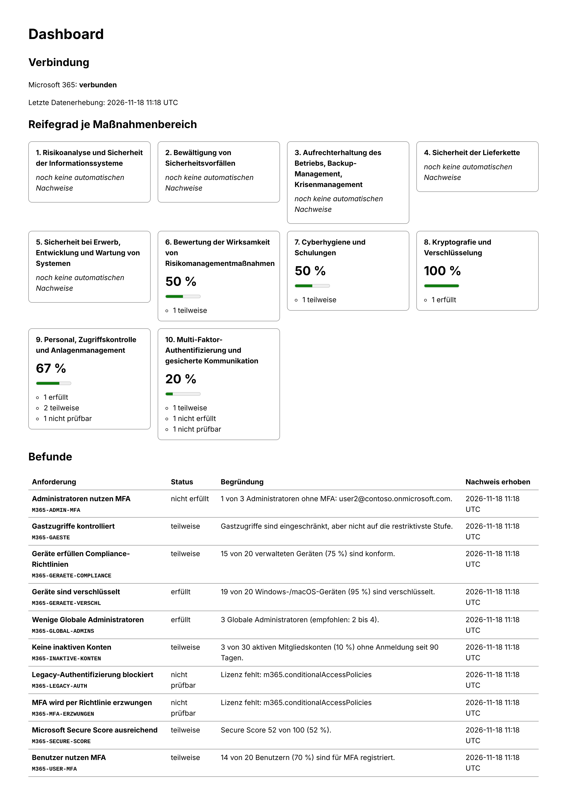

# compliance-agent

KI-gestützter NIS2-Compliance-Agent für kleine und mittlere Unternehmen. Er erhebt Nachweise automatisch aus Microsoft 365 (rein lesend über Microsoft Graph), bewertet sie anhand eines Anforderungskatalogs und zeigt den Reifegrad je Maßnahmenbereich samt nachvollziehbarer Befunde in einem Dashboard. Mandantentrennung per Row-Level-Security, lückenloser Prüfpfad.

## Status

Plan 1 (Fundament und Microsoft 365): Katalog, Regel-Engine mit zehn Prüfungen, Graph-Sammler, Sammel-Job, Verbindung per Admin-Consent, Dashboard mit Demo-Zugang (Basic-Auth). Noch nicht gegen einen echten Tenant getestet, siehe "Erster echter Test" in der Entwicklungsanleitung. Login, Agent-Schicht, Richtlinien und Berichte folgen in späteren Plänen.

## Schnellstart

```bash
pnpm install
pnpm db:up && pnpm db:migrate   # oder eigene Postgres-Instanz über DATABASE_URL
pnpm test
```

### Demo-Modus (ohne Microsoft-Zugang)

```bash
pnpm demo:setup "Demo GmbH" --fake        # gibt Tenant-UUID und Dashboard-URL aus
pnpm demo:collect <tenantUuid> --fake     # Erhebung mit Beispieldaten, Tabelle im Terminal
DEMO_BASIC_AUTH=demo:demo-passwort CONNECT_STATE_SECRET=$(openssl rand -hex 32) pnpm dev
```

Dashboard: `http://localhost:3000/dashboard?tenant=<uuid>`



## Dokumentation

- [Entwicklungsanleitung](docs/entwicklung.md): Tenant, App-Registrierung, Zertifikat, Umgebungsvariablen, erster echter Test
- [Spezifikation](docs/superpowers/specs/2026-11-18-nis2-agent-design.md)
- [Plan 1](docs/superpowers/plans/2026-11-18-plan-1-fundament-m365.md)
- [Agenten-Arbeitsplan](docs/agent-workplan.md): Aufgaben einzeln zuweisen und voneinander abgrenzen

## Zusammenarbeit mit Coding-Agents

`prd.md` ist der gemeinsame Produktauftrag. Die aktuelle Umsetzung und konkreten technischen Entscheidungen stehen in der Spezifikation und den Plänen unter `docs/superpowers/`. Bei einem Widerspruch muss die Aufgabe zuerst die gewünschte Produktentscheidung benennen, statt stillschweigend eine Richtung zu wählen.

Jede laufende Coding-Sitzung arbeitet in genau einem eigenen Git-Worktree und Branch. Die Sitzungen teilen Produktauftrag und Aufgabenplan, aber nicht denselben Arbeitsordner. Vor Änderungen liest der Agent `AGENTS.md` und prüft den aktuellen Branch. Aufgaben werden über `docs/agent-workplan.md` verteilt und erst nach Erfüllung ihrer Akzeptanzkriterien committed.

| Sitzung | Lokaler Ordner | Branch |
| --- | --- | --- |
| Codex Desktop (Koordination/Integration) | `/Users/Alex/compliance-agent` | `codex/desktop-main` |
| Codex Terminal | `/Users/Alex/compliance-agent-codex-cli` | `codex/terminal-main` |
| Claude Desktop | `/Users/Alex/compliance-agent-claude` | `claude/desktop-main` |
| Claude Terminal | `/Users/Alex/compliance-agent-claude-cli` | `claude/terminal-main` |
| Cursor Desktop | `/Users/Alex/compliance-agent-cursor` | `cursor/desktop-main` |
| Cursor Terminal | `/Users/Alex/compliance-agent-cursor-cli` | `cursor/terminal-main` |

Die Branches starten auf einem gemeinsamen Stand. Änderungen werden über task-spezifische Commits und Pull Requests integriert; niemand arbeitet direkt auf `main`. Vor jedem Task werden zuständige Sitzung, betroffene Dateien, Schnittstellen und Abnahmekriterien im Arbeitsplan festgehalten.
